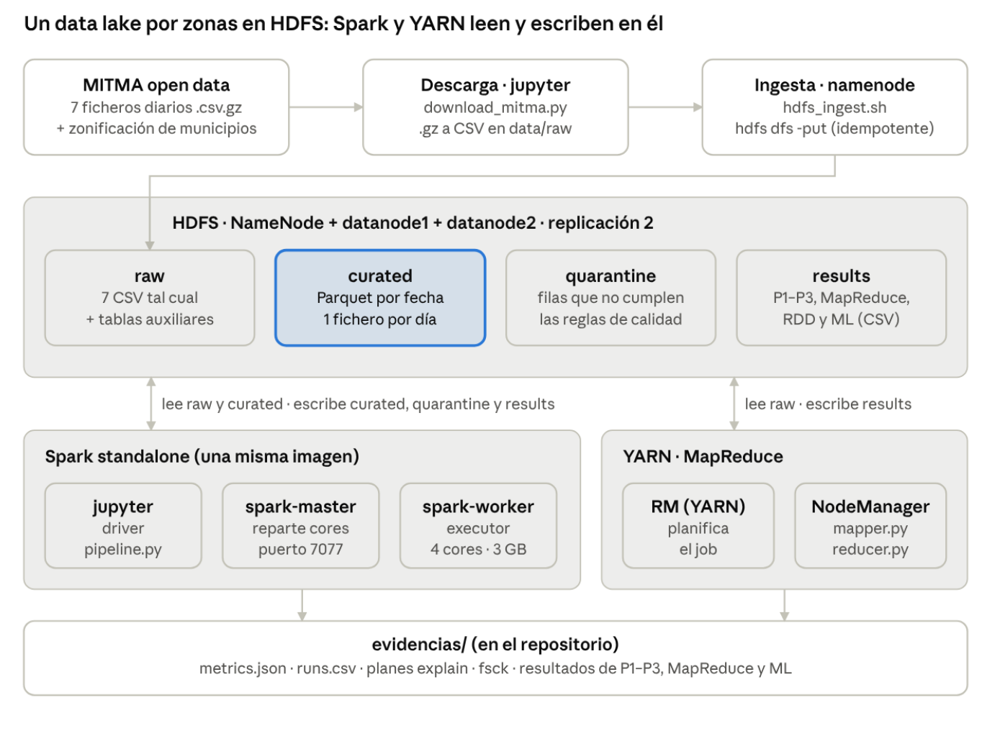

# Movilidad en España con Big Data (MITMA) — Entrega 1

Arquitectura Big Data local (HDFS + YARN + Spark en Docker) sobre la matriz diaria de viajes entre municipios del Ministerio de Transportes (MITMA), para **una semana: del miércoles 26-10-2022 al martes 01-11-2022**. Son 78,3 millones de filas y 6,9 GB de CSV. El 1 de noviembre es festivo nacional.

Proyecto de Big Data & Cloud Computing, curso 2026-27.

**Documento de la entrega:** [`docs/Entrega1_Arquitectura_BigData_MITMA.pdf`](docs/Entrega1_Arquitectura_BigData_MITMA.pdf) (arquitectura, decisiones de diseño, resultados y trazabilidad de cada cifra a `evidencias/`).



## Requisitos previos

| Recurso | Mínimo |
|---|---|
| Docker Desktop con Docker Compose v2 | — |
| RAM asignada a Docker (Settings → Resources) | **8 GB** |
| Disco libre | **31 GB** (3 × 7 GB + 10 GB) |
| Puertos libres | 9870, 9000, 8088, 8080, 8081, 8888, 4040, 4041 |

Recursos que usa el entorno (configurables):

| Componente | Recursos |
|---|---|
| Spark worker | 4 cores, 3 GB (`.env.example`) |
| Executor | 2 GB |
| Driver | 2 GB |
| YARN (MapReduce) | 4 GB y 4 vcores (`hadoop.env`) |

Spark y MapReduce se ejecutan en secuencia, nunca a la vez.

## Ejecución (desde un clon limpio)

```bash
git clone https://github.com/AimarLuis/big-data-mitma.git && cd big-data-mitma
docker compose up -d --build      # 1.ª vez: varios minutos (descarga de imágenes y build del nodemanager)
```

Un único comando ejecuta todo el flujo: descarga → HDFS → Spark → MapReduce → resultados.

```powershell
.\run_pipeline.ps1                # Windows (PowerShell)
```
```bash
./run_pipeline.sh                 # Linux / macOS
```

Si PowerShell bloquea el script, ejecuta `powershell -ExecutionPolicy Bypass -File .\run_pipeline.ps1`, o haz doble clic en `run_pipeline.cmd`, que hace exactamente eso. Toda la salida queda también en `evidencias/pipeline_run.log`.

Con datos descargados, la primera ejecución tarda unos 40–60 minutos en un portátil. La descarga añade unos 900 MB comprimidos. Se puede volver a ejecutar las veces que se quiera: el pipeline es **idempotente**.

| Interfaz | URL |
|---|---|
| NameNode (HDFS) | http://localhost:9870 |
| YARN | http://localhost:8088 |
| Spark master | http://localhost:8080 |
| Spark UI (mientras corre el pipeline) | http://localhost:4040 |
| Jupyter (token `mitma`) | http://localhost:8888 |

### Qué hace cada paso del punto de entrada

| Paso | Dónde se ejecuta | Qué hace |
|---|---|---|
| 1 | `jupyter` | `scripts/download_mitma.py`: descarga los `.csv.gz` que falten y los descomprime en `data/raw/` |
| 2 | `namenode` | `scripts/hdfs_ingest.sh`: `hdfs dfs -put` a la zona **raw** (sin repetir lo que ya está) |
| 3 | `jupyter` → cluster Spark | `src/pipeline.py`: smoke test, **ETL** → curated, **formatos**, **preguntas** + optimización |
| 4 | `namenode` → YARN | `scripts/mr_streaming.sh`: **MapReduce** con Hadoop Streaming (`mapreduce/mapper.py`, `reducer.py`) |
| 5 | `jupyter` → cluster Spark | `src/pipeline.py`: la misma agregación con **RDDs**, **ML** (MLlib) y **desafío F** |
| 6 | `namenode` | `scripts/hdfs_evidence.sh`: `ls -R`, `du`, `count`, `fsck` |

Para ejecutar etapas sueltas de Spark:

```
docker exec jupyter bash /home/jovyan/work/scripts/spark_python.sh src/pipeline.py --stages etl analytics
```

Etapas disponibles: `smoke`, `etl`, `formats`, `analytics`, `mr_rdd`, `ml`, `challenge`.

## Resultados esperados

Cifras de referencia de una ejecución completa. Los conteos son deterministas; los tiempos dependen de la máquina.

| Elemento | Valor esperado |
|---|---|
| Filas en raw / curated | 78.340.906 / 78.340.906 (0 en cuarentena, 0 duplicados) |
| Tamaño raw (CSV) / curated (Parquet) | 6,87 GB / 0,99 GB |
| Ficheros en curated | 7 (uno por `fecha=…`) |
| P1 / P2 / P3 | 52 provincias / 21 filas (7 días × 3) / 6.174 filas (882 municipios × 7) |
| MapReduce y RDD | 364 claves (52 provincias × 7 días), idénticas en las dos versiones |
| ML | 12.815 filas (municipio × edad); R² en test ≈ 0,82 |
| Tiempo total | ~55–60 min (ETL ~13 min, MapReduce ~5 min, desafío F ~20 min) |

| Dónde | Qué |
|---|---|
| HDFS `/raw/mitma/` | 7 CSV de viajes + tabla de municipios + tablas auxiliares (sin modificar) |
| HDFS `/curated/mitma/viajes/fecha=…` | Parquet: **7 carpetas, 1 fichero por día** |
| HDFS `/quarantine/mitma/viajes` | Filas que no cumplen las reglas de calidad |
| HDFS `/results/mitma/` | Resultados de las preguntas, MapReduce y ML (CSV) |
| `evidencias/metrics.json` | Todas las cifras del documento (conteos, tiempos, métricas) |
| `evidencias/runs.csv` | Una línea por ejecución de la ETL: mismos conteos en cada una (idempotencia) |
| `evidencias/resultados/` | Resultados de P1–P3, MapReduce/RDD y predicciones del modelo |
| `evidencias/plan_*.txt` | Planes de ejecución (`explain`) |
| `evidencias/fsck_*.txt`, `hdfs_*.txt` | Bloques, réplicas y estructura de HDFS |
| `evidencias/capturas/` | Capturas de las UIs (NameNode, YARN, Spark UI) |

## Estructura

```
config/pipeline.env      Configuración única: rutas HDFS, fechas, umbrales, Spark, ML
docker-compose.yml       HDFS (NameNode + 2 DataNodes), YARN, Spark master + worker, Jupyter
hadoop.env               Configuración de Hadoop (la del curso, con YARN reducido a 4 GB)
docker/nodemanager/      NodeManager del curso + python3 (para Hadoop Streaming)
run_pipeline.ps1 / .sh   Punto de entrada único
scripts/                 Descarga, ingesta HDFS, MapReduce, evidencias, lanzador de PySpark
src/                     Código Spark: etl, formats, analytics, mr_rdd, ml, challenge, pipeline
mapreduce/               mapper.py y reducer.py (Hadoop Streaming)
data_aux/                Tablas auxiliares construidas: provincias (INE) y calendario (festivos)
evidencias/              Salidas del pipeline que respaldan el documento
docs/                    Documento de la entrega (PDF) y diagrama de arquitectura
data/                    Datos locales (NO se versionan)
```

## Datos y licencia

- **Viajes:** MITMA, *Estudio de movilidad con Big Data*, estudios básicos, matriz diaria por municipios (versión 2, desde 2022). Fuente: https://movilidad-opendata.mitma.es/ . Licencia: datos abiertos del Ministerio de Transportes (reutilización libre con atribución, según el aviso legal del portal).
- **Zonificación:** `zonificacion_municipios/nombres_municipios.csv`, del mismo portal.
- **Tablas auxiliares propias:** `data_aux/provincias.csv` (códigos INE de provincia → provincia y CCAA) y `data_aux/calendario.csv` (tipo de día; 1-11-2022 = festivo nacional).
